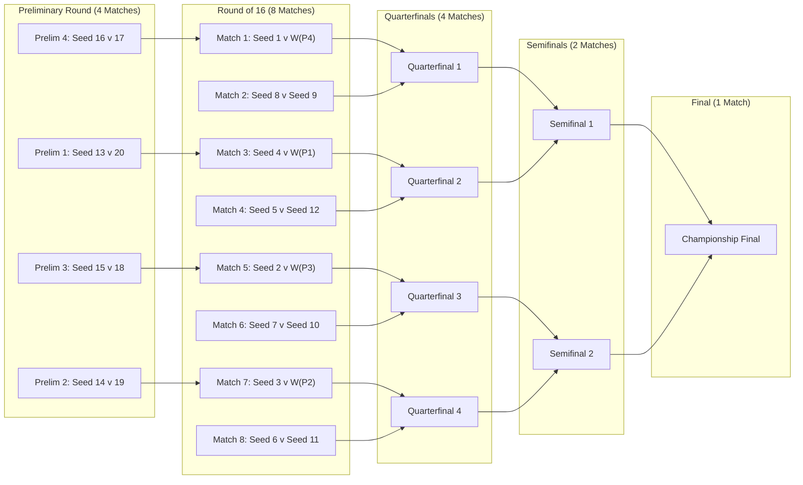

# TAPE eSports Tournament Engine - Frontend Integration Guide
**Version:** 1.2.1  
**Target Audience:** Frontend Developers (Web, Mobile, UI/UX)  
**Last Updated:** November 2026  

---

## Table of Contents
1. [Overview & Architectural Principles](#1-overview--architectural-principles)
2. [Creation Wizard (Step-by-Step UI Flow)](#2-creation-wizard-step-by-step-ui-flow)
   - [Step 1: Tournament Basics & Dynamic Top Q](#step-1-tournament-basics--dynamic-top-q)
   - [Step 2: Venues & Screens](#step-2-venues--screens)
   - [Step 3: Schedule Settings & Defaults](#step-3-schedule-settings--defaults)
   - [Step 4: Frequency & Buffer Dates](#step-4-frequency--buffer-dates)
   - [Step 5: Independent Media & Branding](#step-5-independent-media--branding)
   - [Step 6: Review & Capacity Breakdown](#step-6-review--capacity-breakdown)
3. [Tournament Formats & Match Calculations](#3-tournament-formats--match-calculations)
4. [Group Stage Architecture, Standings & Merit Ranking](#4-group-stage-architecture-standings--merit-ranking-hybrid-formats)
   - [4.1 Group Distribution (Even & Uneven Fields)](#41-group-distribution-even--uneven-fields)
   - [4.2 Group Naming & Entity Structure](#42-group-naming--entity-structure)
   - [4.3 Group Match Mechanics & Two-Legged Fixtures](#43-group-match-mechanics--two-legged-fixtures)
   - [4.4 Group Standings Points & Metrics Table](#44-group-standings-points--metrics-table)
   - [4.5 Cross-Group Merit Ranking & Knockout Seeding](#45-cross-group-merit-ranking--knockout-seeding)
5. [Preliminary Round Reduction (v1.2.1 Core Feature)](#5-preliminary-round-reduction-v121-core-feature)
   - [The Mathematical Formula](#the-mathematical-formula)
   - [40 Teams in 10 Groups Golden Example](#40-teams-in-10-groups-golden-example)
   - [Bracket UI Column Structure & Flow](#bracket-ui-column-structure--flow)
6. [Double Elimination & Placement Rules](#6-double-elimination--placement-rules)
7. [Participant Reference Types & Placeholder Rendering](#7-participant-reference-types--placeholder-rendering)
8. [API Endpoints & Request/Response Payloads](#8-api-endpoints--requestresponse-payloads)
9. [Capacity & Calendar Model](#9-capacity--calendar-model)
10. [TypeScript Type Definitions](#10-typescript-type-definitions)

---

## 1. Overview & Architectural Principles

The TAPE eSports Tournament Scheduling Engine is built around a **durable canonical competition graph**. 
- **Graph is Immutable to Rescheduling:** Opponents and progression are generated once by the backend. Match allocation to physical calendar slots (venues, screens, dates, times) is handled separately without changing the competition graph.
- **No Synthetic BYEs for Hybrids:** In v1.2.1, when the qualified entrant count $N$ is not a power of 2, the engine emits **Preliminary Round matches** instead of generating synthetic BYE nodes.
- **Zero Fabrication:** Registrations, group standings, and match scores resolve into the existing slots. Unassigned or unqualified slots are displayed as typed placeholders rather than fake players.

---

## 2. Creation Wizard (Step-by-Step UI Flow)

The tournament creation wizard contains 6 visible steps:

```
[1. Basics] ➔ [2. Venues] ➔ [3. Schedule] ➔ [4. Frequency] ➔ [5. Media] ➔ [6. Review & Generate]
```

### Step 1: Tournament Basics & Dynamic Top Q
- **Format Selection:**
  - `LEAGUE` (Single Round Robin)
  - `LEAGUE_DOUBLE` (Double Round Robin)
  - `SINGLE_ELIMINATION`
  - `DOUBLE_ELIMINATION`
  - `LEAGUE_AND_KNOCKOUT` (Single Hybrid)
  - `LEAGUE_AND_KNOCKOUT_DOUBLE` (Double Hybrid)
- **Teams ($T$):** Minimum 2. (Recommended: 4, 8, 16, 20, 32, 40, etc.).
- **Groups Count ($G$):** Visible only for hybrid formats.
  - Constraint: $1 \le G \le \lfloor T / 2 \rfloor$.
  - Wizard default proposal: $\max(1, \lfloor T / 4 \rfloor)$.
- **Top Qualifiers ($Q$ / Top Q):**
  - **New in v1.2.1:** Dynamic integer input (defaults to `2`).
  - Constraint: $1 \le Q \le \text{smallest group size}$.
  - E.g., for 10 groups of 4 teams: $Q = 2 \implies N = 20$ qualifiers.

### Step 2: Venues & Screens
- Configure physical venues and the number of screens available at each venue.
- Total concurrent screens ($S$) across all venues dictates daily capacity.

### Step 3: Schedule Settings & Defaults
- **Scheduling Mode:**
  - `MANUAL`: Generates empty calendar; Admin assigns matches to slots.
  - `AUTO_RANDOM`: Automatically schedules matches across available slots.
  - `AUTO_HOME_VENUE`: Prioritizes matching players to their designated home venue.
  - `PLAYER_SELF`: Generates empty calendar; players book their own matches within an open time window.
- **Match Duration ($d$):** In minutes (e.g. 25 min or 30 min).
- **Turnover Duration ($t$):** In minutes between matches (e.g. 5 min).
- **Lunch Break:** Optional start time and duration (e.g. 13:00 to 14:00, 60 min).
- **Third Place Playoff (`thirdPlacePlayoffEnabled`):**
  > [!IMPORTANT]
  > In v1.2.1, this toggle **MUST DEFAULT TO FALSE** (Unchecked).
  > Only applicable to Single Elimination and Hybrids. Double Elimination has NO third-place playoff.
- **Grand Final Reset (`hasGrandFinalReset`):**
  - Only for Double Elimination. Defaults to `true`.

### Step 4: Frequency & Buffer Dates
- **Frequency Type:** `DAILY`, `WEEKLY`, or `MONTHLY`.
- **Allowed Weekdays (`playingDays`):** Array of day indices (`0` = Sun, `1` = Mon, ..., `6` = Sat).
- **Buffer Dates (`buffer`):** Extra reserve days appended at the end of the tournament (integer $\ge 0$).

### Step 5: Independent Media & Branding
Six completely decoupled media fields:
1. `tournamentLogo`: Square logo displayed in cards and headers.
2. `tournamentBanner`: Hero/wide banner for tournament overview.
3. `primaryOrganization`: Main sponsor or organizer badge.
4. `secondaryOrganization`: Secondary partner badge.
5. `fanPassLogo`: Logo rendered specifically on the Fan Pass ticket.
6. `fanPassBg`: Background canvas image for Fan Pass card rendering.
*(Updating tournament banner does NOT touch or overwrite fan pass background).*

### Step 6: Review & Capacity Breakdown
Displays calculated totals before final submission. The backend returns:
- `baselineDays`: Regular days needed for guaranteed matches ($\lceil M / C \rceil$).
- `reserveDays`: Backup days needed for conditional matches (like Grand Final Reset).
- `bufferDays`: User-configured buffer days.
- `totalPlayingDaysNeeded`: Sum of $B + R + F$.

---

## 3. Tournament Formats & Match Calculations

| Format Code | Guaranteed Real Matches | Conditional Matches | Sporting Rules |
| :--- | :--- | :--- | :--- |
| `LEAGUE` | $\frac{T(T-1)}{2}$ | $0$ | Single round-robin. Every pair plays once. |
| `LEAGUE_DOUBLE` | $T(T-1)$ | $0$ | Double round-robin. Every pair plays twice (home & away). |
| `SINGLE_ELIMINATION` | $T - 1 + H$ | $0$ | Single knockout bracket ($H=1$ if 3rd place enabled, else $0$). |
| `DOUBLE_ELIMINATION` | $2T - 2$ | $1$ (GF Reset) | Winners & Losers brackets. Reset activated if LB champion wins GF. |
| `LEAGUE_AND_KNOCKOUT` | $\sum \frac{n_i(n_i-1)}{2} + (N - 1 + H)$ | $0$ | Group stage RR + Single leg knockout (via Preliminary reduction). |
| `LEAGUE_AND_KNOCKOUT_DOUBLE` | $\sum n_i(n_i-1) + (2N - 3 + H)$ | $0$ | Double group RR + 2-leg knockout ties on aggregate + 1-leg Final. |

*Where:*
- $T$ = Total teams / competitive entrants
- $n_i$ = Size of group $i$
- $G$ = Number of groups
- $Q$ = Top qualifiers per group
- $N = G \times Q$ = Total qualified entrants advancing to knockout
- $H$ = Third-place match ($1$ if enabled and $\ge 4$ teams, else $0$)

---

## 4. Group Stage Architecture, Standings & Merit Ranking (Hybrid Formats)

In hybrid formats (`LEAGUE_AND_KNOCKOUT` and `LEAGUE_AND_KNOCKOUT_DOUBLE`), the tournament begins with a group stage where teams are divided into pools, compete within their groups, and top finishers advance to the knockout bracket.

### 4.1 Group Distribution (Even & Uneven Fields)
When dividing $T$ teams into $G$ groups:
- **Base Group Size:** $\lfloor T / G \rfloor$
- **Remainder:** $R_{\text{mod}} = T \bmod G$
- **Distribution Rule:** The first $R_{\text{mod}}$ groups receive $(\lfloor T / G \rfloor + 1)$ teams; the remaining groups receive $\lfloor T / G \rfloor$ teams.

**Examples:**
- **40 Teams in 10 Groups:**  
  $40 \div 10 = 4$ teams in every group (10 groups of 4 teams).  
  Matches per group = $\frac{4 \times 3}{2} = 6$.  
  Total group matches = $10 \times 6 = \mathbf{60 \text{ matches}}$.
- **10 Teams in 3 Groups (Uneven):**  
  $10 \div 3 = 3$ remainder 1.  
  Group A: 4 teams; Group B: 3 teams; Group C: 3 teams.  
  Matches = $\frac{4 \times 3}{2} + \frac{3 \times 2}{2} + \frac{3 \times 2}{2} = 6 + 3 + 3 = \mathbf{12 \text{ matches}}$ *(never use group averages!)*.

### 4.2 Group Naming & Entity Structure
- Groups are automatically named alphabetically: `Group A`, `Group B`, `Group C`, ..., `Group J`.
- Each group owns:
  - `id`: Stable string ID (e.g. `group-trn-1-1`)
  - `name`: Display string (`Group A`)
  - `slotNumbers`: Array of tournament slot numbers belonging to this group (e.g. `[1, 2, 3, 4]`).
  - `standings`: Real-time computed standings derived exclusively from completed `GROUP` matches.

### 4.3 Group Match Mechanics & Two-Legged Fixtures
- **Single Hybrid (`LEAGUE_AND_KNOCKOUT`):**
  - Each group pair plays once ($S(S-1)/2$ matches per group).
  - Round name: `'Group Stage'`.
- **Double Hybrid (`LEAGUE_AND_KNOCKOUT_DOUBLE`):**
  - Each group pair plays twice ($S(S-1)$ matches per group).
  - Leg 1: Team A vs Team B (`round: 'Group Stage'`).
  - Leg 2: Team B vs Team A (`round: 'Group Stage (Leg 2)'`, home and away reversed).

### 4.4 Group Standings Points & Metrics Table
Group standings are derived only from completed canonical matches.

| Metric | Code Field | Description | Calculation Rule |
| :--- | :--- | :--- | :--- |
| **Played** | `played` | Total matches completed | Incremented when status is `COMPLETED` |
| **Wins** | `wins` | Matches won | +3 Points |
| **Draws** | `draws` | Matches tied | +1 Point |
| **Losses** | `losses` | Matches lost | 0 Points |
| **Goals For** | `goalsFor` / `GF` | Goals scored | Sum of team's scores |
| **Goals Against** | `goalsAgainst` / `GA`| Goals conceded | Sum of opponent's scores |
| **Goal Difference** | `goalDifference` / `GD`| Net difference | `goalsFor - goalsAgainst` |
| **Points** | `points` / `PTS` | Total sporting points | $(3 \times \text{wins}) + (1 \times \text{draws})$ |
| **Fair Play** | `fairPlayPenaltyPoints`| Disciplinary penalty | Lower is better (omitted defaults to 0) |

#### UI Table Example for Group A:
```
┌─────┬───────────────────────┬────┬───┬───┬───┬────┬────┬─────┬─────┐
│ POS │ TEAM / PLAYER         │ P  │ W │ D │ L │ GF │ GA │ GD  │ PTS │
├─────┼───────────────────────┼────┼───┼───┼───┼────┼────┼─────┼─────┤
│  1  │ Tariq Rahman (Seed 1) │ 3  │ 3 │ 0 │ 0 │  8 │  1 │  +7 │   9 │ ➔ Qualified (Top 2)
│  2  │ Arman Hossain (Seed 2)│ 3  │ 2 │ 0 │ 1 │  5 │  3 │  +2 │   6 │ ➔ Qualified (Top 2)
├─────┴───────────────────────┴────┴───┴───┴───┴────┴────┴─────┴─────┤ ◄── Qualification Cutoff Line
│  3  │ Team Phantom          │ 3  │ 1 │ 0 │ 2 │  3 │  6 │  -3 │   3 │ ✕ Eliminated
│  4  │ Team Striker          │ 3  │ 0 │ 0 │ 3 │  1 │  7 │  -6 │   0 │ ✕ Eliminated
└─────┴───────────────────────┴────┴───┴───┴───┴────┴────┴─────┴─────┘
```

> [!TIP]
> In the frontend UI table, highlight the top $Q$ rows (e.g. rows 1 and 2) with a green/amber accent or a badge indicating advancement to the knockout stage. Render a dashed divider below row $Q$ to visually separate advancing teams from eliminated teams.

### 4.5 Cross-Group Merit Ranking & Knockout Seeding
Once group matches are complete, the engine ranks the $N = G \times Q$ qualifiers into Seeds $1$ through $N$ for the knockout bracket using a strict hierarchical sequence:

#### Rule 1: Qualification Tier Always Precedes Statistics
- **Tier 1 (Group Winners):** The $G$ group winners occupy **Seeds 1 through $G$**.
- **Tier 2 (Runners-up):** The $G$ runners-up occupy **Seeds $G+1$ through $2G$**.
- **Tier 3 (Third-place qualifiers, if $Q \ge 3$):** Occupy **Seeds $2G+1$ through $3G$**.
- *Crucial Sporting Rule:* A high-scoring runner-up NEVER outranks a group winner in seed ranking, regardless of how many points or goals they scored.

#### Rule 2: Within-Tier Tie-Breaking Sequence
When ranking teams within the same tier (e.g. ranking the 10 group winners against each other for Seeds 1 to 10):
1. **Points (`PTS`):** Higher points ranks first.
2. **Goal Difference (`GD`):** Higher goal difference ranks first.
3. **Goals For (`GF`):** More goals scored ranks first.
4. **Total Wins (`W`):** More wins ranks first.
5. **Fair Play Penalties (`fairPlayPenaltyPoints`):** Lower penalty points ranks first.
6. **Persisted Draw Order:** If teams remain tied after fair play, a random/manual draw determines placement (`DRAW_REQUIRED`).

#### Rule 3: Unequal Games Played (Rate Comparison)
If groups have unequal sizes (e.g. one group of 4 teams and one of 3 teams):
- The engine compares points-per-game (`PTS/P`), goal-difference-per-game (`GD/P`), goals-per-game (`GF/P`), and wins-per-game (`W/P`) using cross-multiplication before checking fair play.

---

## 5. Preliminary Round Reduction (v1.2.1 Core Feature)

When the knockout entrant count $N$ is **NOT** a power of 2 (e.g. 20, 24, 12, 45):
The v1.2.1 engine eliminates synthetic BYEs and introduces a **Preliminary Round**.

### The Mathematical Formula
1. **Target Main Bracket Size ($R$):**
   $$R = 2^{\lfloor \log_2(N) \rfloor} \quad \text{(Largest power of 2 not exceeding } N\text{)}$$
2. **Preliminary Ties ($P$):**
   $$P = N - R$$
3. **Direct Advancements ($D$):**
   $$D = 2R - N$$
4. **Participants:**
   - **Seeds $1$ to $D$:** Advance directly to the Round of $R$ (Skip preliminary round).
   - **Seeds $D+1$ to $N$:** Compete in the Preliminary Round ($2P$ teams).
5. **Pairing Rule (for $k = 0 \dots P-1$):**
   $$\text{Seed } (D + 1 + k) \quad \text{vs} \quad \text{Seed } (N - k)$$
6. **Effective Seed Assignment:**
   The winner of pair $k$ occupies **effective seed $(D + 1 + k)$** in the standard $R$-bracket.

---

### 40 Teams in 10 Groups Golden Example
- Inputs: $T = 40, G = 10, Q = 2 \implies N = 20$ qualifiers.
- Group Stage: $10 \times \frac{4 \times 3}{2} = 60$ matches.
- Target Bracket Size: $R = 16$.
- Preliminary Ties: $P = 20 - 16 = 4$ ties.
- Direct Entries: $D = 2(16) - 20 = 12$ teams (Seeds 1 to 12).
- Preliminary Teams: Seeds 13 to 20 (8 teams).

#### Preliminary Round Pairings:
| Match ID | Match Name | Competitors | Winner Becomes |
| :--- | :--- | :--- | :--- |
| `match-ko-prelim-1` | Preliminary Round | Seed 13 vs Seed 20 | **Effective Seed 13** |
| `match-ko-prelim-2` | Preliminary Round | Seed 14 vs Seed 19 | **Effective Seed 14** |
| `match-ko-prelim-3` | Preliminary Round | Seed 15 vs Seed 18 | **Effective Seed 15** |
| `match-ko-prelim-4` | Preliminary Round | Seed 16 vs Seed 17 | **Effective Seed 16** |

#### Round of 16 Pairings (Standard 16-Bracket Placement):
```
R16 Match 1: Seed 1  vs  Winner of Prelim 4 (Seed 16)
R16 Match 2: Seed 8  vs  Seed 9
R16 Match 3: Seed 4  vs  Winner of Prelim 1 (Seed 13)
R16 Match 4: Seed 5  vs  Seed 12
R16 Match 5: Seed 2  vs  Winner of Prelim 3 (Seed 15)
R16 Match 6: Seed 7  vs  Seed 10
R16 Match 7: Seed 3  vs  Winner of Prelim 2 (Seed 14)
R16 Match 8: Seed 6  vs  Seed 11
```

*Total Knockout Matches:* $4 \text{ (Prelim)} + 8 \text{ (R16)} + 4 \text{ (QF)} + 2 \text{ (SF)} + 1 \text{ (Final)} = \mathbf{19 \text{ matches}}$.  
*Total Guaranteed Matches:* $60 + 19 = \mathbf{79 \text{ matches}}$ (or $80$ with 3rd place).

---

### Bracket UI Column Structure & Flow

In the frontend bracket component, render the rounds from left to right as follows:



> [!TIP]
> Seeds 1 through 12 skip the preliminary column and appear directly in the Round of 16. Ensure the UI connectors visually connect Prelim 4 to Match 1, Prelim 1 to Match 3, Prelim 3 to Match 5, and Prelim 2 to Match 7.

---

## 6. Double Elimination & Placement Rules

In Double Elimination tournaments, **do not render a 3rd Place Match card**. The tournament derives official placements directly from the graph:

| Finish Position | Entity in Competition Graph |
| :--- | :--- |
| **1st Place (Champion)** | Winner of Grand Final (or Grand Final Reset if reset occurred) |
| **2nd Place (Runner-up)** | Loser of Grand Final (or Loser of Grand Final Reset) |
| **3rd Place** | Loser of the **Losers Final** |
| **4th Place** | Loser of the **Losers Pre-Final** (the match feeding into Losers Final) |

### Grand Final Reset State Handling
1. The Grand Final Reset match exists in the match list with `conditional: true` and `isSchedulable: false`.
2. While the tournament is running, the frontend can either hide the Reset card or show it with an **"Inactive / If Necessary"** badge.
3. If the Losers Bracket champion wins the first Grand Final, the backend activates the Reset match (`isSchedulable: true`), and the UI should render it as an active playable match.

---

## 7. Participant Reference Types & Placeholder Rendering

Matches contain `participant1Ref` and `participant2Ref`. Render appropriate badges and placeholder text based on `type`:

```typescript
export type MatchParticipantRefType =
  | 'TOURNAMENT_SLOT'    // e.g. "Slot 1"
  | 'SEED'               // e.g. "Seed 1"
  | 'GROUP_POSITION'     // e.g. "Group A #1", "Group B #2"
  | 'QUALIFIER_SEED'     // e.g. "Qualifier Seed #13"
  | 'MATCH_WINNER'       // e.g. Winner of another match ID
  | 'MATCH_LOSER'        // e.g. Loser of another match ID
  | 'TIE_WINNER'         // e.g. Winner of 2-leg tie ID
  | 'TIE_LOSER'          // e.g. Loser of 2-leg tie ID
  | 'PARTICIPANT'        // Concrete player/team ID
  | 'BYE';               // BYE advancement
```

### UI Label Resolution Helper
```typescript
export function getParticipantDisplayLabel(
  ref: MatchParticipantRef,
  allMatches?: TournamentMatchEntity[],
): { text: string; badgeColor: 'amber' | 'blue' | 'gray' | 'green' } {
  if (!ref) return { text: 'TBD', badgeColor: 'gray' };

  switch (ref.type) {
    case 'PARTICIPANT':
      return { text: ref.displayName || ref.value, badgeColor: 'green' };

    case 'GROUP_POSITION':
      // "Group A #1" -> Group Winner (amber), "Group A #2" -> Runner up (blue)
      const isWinner = ref.value.endsWith('#1');
      return { text: ref.value, badgeColor: isWinner ? 'amber' : 'blue' };

    case 'QUALIFIER_SEED':
      return { text: `Qualifier Seed #${ref.value}`, badgeColor: 'blue' };

    case 'SEED':
      return { text: `Seed #${ref.value}`, badgeColor: 'amber' };

    case 'MATCH_WINNER': {
      const sourceMatch = allMatches?.find((m) => m.id === ref.value);
      if (sourceMatch?.round === 'Preliminary Round') {
        return { text: `Winner of Prelim ${sourceMatch.matchNumber}`, badgeColor: 'gray' };
      }
      return { text: `Winner of ${sourceMatch?.round || 'Match'}`, badgeColor: 'gray' };
    }

    case 'TIE_WINNER':
      return { text: `Winner of Tie`, badgeColor: 'gray' };

    case 'BYE':
      return { text: 'BYE', badgeColor: 'gray' };

    default:
      return { text: ref.value || 'TBD', badgeColor: 'gray' };
  }
}
```

---

## 8. API Endpoints & Request/Response Payloads

### 1. Create Tournament Schedule
`POST /api/v1/tournaments` or `POST /api/v1/tournaments/{id}/calendar`

```json
{
  "tournamentId": "trn-40-hybrid",
  "tournamentName": "Apex Spring Championship 2026",
  "tournamentFormat": "LEAGUE_AND_KNOCKOUT",
  "schedulingMode": "MANUAL",
  "numberOfTeams": 40,
  "groupsCount": 10,
  "topQualifiers": 2,
  "thirdPlacePlayoffEnabled": false,
  "startDate": "2026-11-20",
  "dailyStart": "09:00",
  "dailyEnd": "17:00",
  "matchDuration": 30,
  "turnoverDuration": 0,
  "buffer": 2,
  "frequencyStatus": "DAILY",
  "venues": [
    {
      "venueId": "venue-arena-1",
      "name": "Esports Arena",
      "screens": [
        { "screenId": "screen-1", "screenName": "Screen 1" },
        { "screenId": "screen-2", "screenName": "Screen 2" }
      ]
    }
  ]
}
```

### 2. Schedule Response Structure
```json
{
  "capacity": {
    "matchTimeMinutes": 30,
    "operatingMinutes": 480,
    "slotsPerScreenPerDay": 16,
    "totalScreens": 2,
    "totalDailySlots": 32,
    "totalMatches": 79,
    "baselineDays": 3,
    "reserveDays": 0,
    "bufferDays": 2,
    "totalPlayingDaysNeeded": 5,
    "eventDates": [
      "2026-11-20",
      "2026-11-21",
      "2026-11-22",
      "2026-11-23",
      "2026-11-24"
    ]
  },
  "structure": {
    "summary": {
      "totalCompetitionMatches": 79,
      "schedulableMatches": 79,
      "groupStageMatches": 60,
      "knockoutMatches": 19,
      "autoAdvanceCount": 0
    },
    "matches": [
      {
        "id": "match-trn-40-hybrid-ko-prelim-1",
        "round": "Preliminary Round",
        "bracketSection": "WINNERS",
        "matchNumber": 1,
        "participant1Ref": { "type": "GROUP_POSITION", "value": "Group C #2" },
        "participant2Ref": { "type": "GROUP_POSITION", "value": "Group J #2" },
        "status": "SCHEDULED",
        "isSchedulable": true
      }
    ]
  }
}
```

### 3. Record Match Score
`POST /api/v1/matches/{id}/score`
```json
{
  "score1": 2,
  "score2": 1,
  "expectedVersion": 1
}
```

---

## 9. Capacity & Calendar Model

When displaying scheduling details or time slots to the tournament organizer:
- **Operating Window:** $W = (\text{dailyEnd} - \text{dailyStart}) - \text{lunchDuration}$
- **Slots Per Screen Per Day:** $S_{\text{daily}} = \lfloor W / (\text{matchDuration} + \text{turnoverDuration}) \rfloor$
- **Total Concurrent Capacity:** $C = S_{\text{daily}} \times \text{TotalScreens}$
- **Baseline Playing Days:** $B = \lceil \text{totalMatches} / C \rceil$
- **Conditional Reserve Days:** $R = \max(0, \lceil (\text{totalMatches} + \text{conditionalMatches}) / C \rceil - B)$
- **Buffer Days:** $F = \lfloor \text{buffer} \rfloor$
- **Total Scheduled Days:** $D_{\text{total}} = B + R + F$

---

## 10. TypeScript Type Definitions

Save this into your frontend codebase (e.g. `src/types/tournament-engine.ts`):

```typescript
export type TournamentFormat =
  | 'LEAGUE'
  | 'LEAGUE_DOUBLE'
  | 'SINGLE_ELIMINATION'
  | 'DOUBLE_ELIMINATION'
  | 'LEAGUE_AND_KNOCKOUT'
  | 'LEAGUE_AND_KNOCKOUT_DOUBLE';

export type SchedulingMode =
  | 'MANUAL'
  | 'AUTO_RANDOM'
  | 'AUTO_HOME_VENUE'
  | 'PLAYER_SELF';

export type MatchParticipantRefType =
  | 'TOURNAMENT_SLOT'
  | 'SEED'
  | 'GROUP_POSITION'
  | 'QUALIFIER_SEED'
  | 'MATCH_WINNER'
  | 'MATCH_LOSER'
  | 'TIE_WINNER'
  | 'TIE_LOSER'
  | 'PARTICIPANT'
  | 'BYE';

export interface MatchParticipantRef {
  type: MatchParticipantRefType;
  value: string;
  displayName?: string;
  sourceMatchId?: string;
}

export interface TournamentMatchEntity {
  id: string;
  round: string;
  bracketSection: 'GROUP' | 'WINNERS' | 'LOSERS' | 'FINAL';
  matchNumber?: number;
  participant1Ref: MatchParticipantRef;
  participant2Ref: MatchParticipantRef;
  player1Id?: string;
  player1Name?: string;
  player2Id?: string;
  player2Name?: string;
  score1: number | null;
  score2: number | null;
  winnerId?: string;
  status: 'SCHEDULED' | 'IN_PROGRESS' | 'COMPLETED' | 'CANCELLED';
  isAutoAdvance: boolean;
  isSchedulable: boolean;
  conditional?: boolean;
  conditionType?: 'GRAND_FINAL_RESET';
  tieId?: string;
  legNumber?: number;
  legCount?: number;
  aggregateAdvancement?: boolean;
  version?: number;
}

export interface TournamentCapacityResult {
  matchTimeMinutes: number;
  operatingMinutes: number;
  slotsPerScreenPerDay: number;
  totalScreens: number;
  totalDailySlots: number;
  totalMatches: number;
  baselineDays: number;
  reserveDays: number;
  bufferDays: number;
  totalPlayingDaysNeeded: number;
  eventDates: string[];
}

export interface TournamentStructureSummary {
  structuralNodes: number;
  totalCompetitionMatches: number;
  schedulableMatches: number;
  groupStageMatches: number;
  knockoutMatches: number;
  winnersBracketMatches: number;
  losersBracketMatches: number;
  finalMatches: number;
  conditionalMatches: number;
  autoAdvanceCount: number;
}
```

